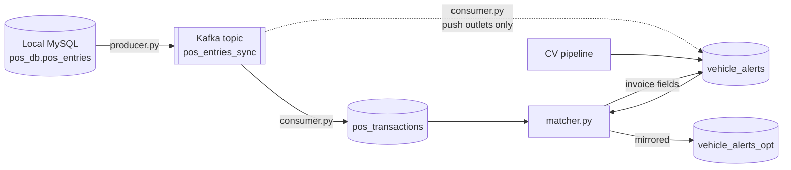

# POS Sync

Streams point-of-sale invoices from a store-side MySQL database to a GCP-hosted MySQL database through Kafka. It then attributes each invoice to the computer-vision vehicle alert whose visit window contains it. The result is one record per vehicle visit: when the car reached the counter, when it left, and what was bought.

## How it works



| File | Role |
|---|---|
| `producer.py` | Polls `pos_entries` by id in batches of 5,000 and publishes each row to Kafka. Rows are keyed by `invoice_id`, so every copy of an invoice lands on the same partition, in order. The last id sent is checkpointed only after Kafka acknowledges the whole batch. |
| `consumer.py` | Upserts one `pos_transactions` row per `(invoice_id, date)`. An identical re-send changes nothing. A re-send with new line items is merged in, and the amount is repriced from the lines. For stores listed in `pos_push_outlets`, it also inserts a `vehicle_alerts` row for each new invoice. |
| `matcher.py` | Assigns invoices to camera alerts and writes the invoice IDs, amount and items onto each alert. Runs continuously, or once over a date range for backfills. |
| `common.py` | Shared settings, the GCP connection, time helpers and a cached `outlets.store_number → outlets.id` map. |

## Requirements

- Python 3.8+
- A Kafka broker
- The store-side MySQL database (source) and the GCP MySQL database (target)

```bash
pip install pymysql kafka-python
```

## Configuration

All shared settings are read from environment variables. `GCP_DB_PASSWORD` has no default, so it never has to live in the repo; set it in the environment or a systemd `EnvironmentFile`.

| Variable | Default | Used by | Purpose |
|---|---|---|---|
| `KAFKA_BROKER` | `localhost:9093` | producer, consumer | Kafka bootstrap server |
| `POS_TOPIC` | `pos_entries_sync` | producer, consumer | Topic name |
| `GCP_DB_HOST` | — | consumer, matcher | GCP MySQL host |
| `GCP_DB_PORT` | `3306` | consumer, matcher | GCP MySQL port |
| `GCP_DB_USER` | — | consumer, matcher | GCP MySQL user |
| `GCP_DB_NAME` | — | consumer, matcher | GCP MySQL database |
| `GCP_DB_PASSWORD` | **required** | consumer, matcher | GCP MySQL password |
| `VA_TABLE` | `vehicle_alerts` | consumer, matcher | Alerts table |
| `VA_OPT_TABLE` | `vehicle_alerts_opt` | consumer, matcher | Mirror table that also receives updates. Set to empty to turn mirroring off. |
| `LOG_LEVEL` | `INFO` | all | Python logging level |
| `POS_PRODUCER_CHECKPOINT` | `producer_last_id.txt` | producer | Checkpoint file |
| `POS_CONSUMER_GROUP` | `pos-gcp-sink` | consumer | Kafka consumer group |
| `POS_DEAD_LETTER_FILE` | `dead_letter.jsonl` | consumer | Where rejected messages are written |
| `MATCHER_STATE_FILE` | `matcher_state.json` | matcher | Change-feed position |
| `MATCHER_POLL_SECONDS` | `15` | matcher | Seconds between live cycles |
| `MATCHER_MAX_ALERT_SPAN_MIN` | `60` | matcher | Longest gap expected between an alert's `created_at` and any moment of its visit window |
| `MATCHER_SWEEP_EVERY_MIN` | `30` | matcher | How often the safety-net sweep runs |
| `MATCHER_SWEEP_LOOKBACK_HOURS` | `2` | matcher | How much recent history each sweep re-matches |

The producer's source database connection is set in `LOCAL_DB_CONFIG` at the top of `producer.py`. It defaults to a MySQL container on `127.0.0.1:3307`, database `pos_db`. `DEFAULT_START_ID` in the same file is the id the producer starts after when no checkpoint exists.

## Running

```bash
export GCP_DB_HOST=... GCP_DB_USER=... GCP_DB_NAME=... GCP_DB_PASSWORD=...

python producer.py              # resume from the checkpoint
python producer.py 28850042     # start after this pos_entries.id instead (one-off override)

python consumer.py

python matcher.py                     # follow changes in real time
```

Run all three from the same working directory: the checkpoint, state and dead-letter files are relative paths. Each process waits and retries if Kafka or MySQL is unreachable, so start order doesn't matter.

### Backfills and re-runs

```bash
python matcher.py --date 2026-10-21                                     # one day, all outlets
python matcher.py --date 2026-10-21 --end-date 2026-10-25 --outlets 12,40
python matcher.py --date 2026-10-21 --replace --dry-run                 # count what --replace would clear
```

| Option | Effect |
|---|---|
| `--date` | Match this day once and exit |
| `--end-date` | Last day of the range, inclusive (needs `--date`) |
| `--outlets` | Comma-separated `outlets.id` values (default: every outlet with alerts that day) |
| `--replace` | Also clear invoice data written by other processes from alerts that win no invoices, but only when `pos_transactions` has every one of those invoices |
| `--dry-run` | Log what would change, write nothing |
| `--start-from-now` | Save a change-feed position 15 minutes before now and exit (see below) |

Re-running any range is safe. Results are recomputed from scratch, and unchanged rows are skipped.

On its first start with no state file, the live matcher re-checks the last 24 hours. If the state file is missing but a matcher was running until just now (for example, after moving to a new host), run `python matcher.py --start-from-now` first. The next start then picks up from 15 minutes ago instead.

## Matching rules

- An invoice can only go to an alert at the same outlet whose `start_time → end_time` window contains the invoice's date and time.
- If several windows contain it (two cars at the counter at once), it goes to the alert whose `start_time` is closest to the invoice time. Ties go to the lower alert id. Each invoice counts on at most one alert.
- Windows are compared as full timestamps, so a visit that crosses midnight (`23:59:30 → 00:01:10`) picks up invoices dated the next day.
- Only alerts with `type = 'Turn Around Time'`, `pushed_through_pos = 0` and `is_fake = 0` are touched. NULL flags count as 0.
- An alert that wins several invoices stores all of them: `invoice_id` and `pos_id` comma-separated in time order, `amount` summed, and `items` as `{"<invoice_id>": "{\"items\": [...]}"}`.
- An alert that wins nothing is cleared only if the matcher wrote it before (`pos_id` is set). Invoice data from other processes is left alone unless a `--date` run is given `--replace`.

### Live mode

Every cycle (15 s by default), the matcher:

1. Finds invoices inserted or merged since the last cycle (by `pos_transactions.updated_at`) and new alerts (by `vehicle_alerts.id`).
2. Re-matches only the outlets and time spans those changes touch.
3. Re-copies any recent rows that the `vehicle_alerts_opt` sync copied after they had changed.

On top of that, every 30 minutes it sweeps the last 2 hours for all outlets, to catch anything the change feed missed. Every 5 minutes it fills in `pos_transactions.outlet` for stores that have since been added to `outlets`.

### Push outlets

Stores listed in `pos_push_outlets` with `enabled = 1` get a `vehicle_alerts` row for every invoice timed after their `enabled_from`, inserted by the consumer with `pushed_through_pos = 1`. No camera measured these visits, so `start_time` is the invoice time, `tat` is a random value between 0:01:21 and 0:03:01, and `end_time` is `start_time + tat`. When a later re-send adds items to the invoice, the row's items and amount are refreshed. The matcher never touches these rows.

### The `vehicle_alerts_opt` mirror

A separate Kafka sync (not in this repo) copies new rows from `vehicle_alerts` into `vehicle_alerts_opt`, but not later changes. So the consumer and matcher write every update to both tables. The matcher also repairs rows the other sync copied after they had changed.

### Time zones

POS `date`/`time` and alert `created_at` are Saudi local time (UTC+3, no DST). The producer sets its session to `Asia/Riyadh`. The GCP server's own clock (`NOW()`, `updated_at`) is UTC, and the matcher converts between the two.

## Reliability

- **Producer:** the checkpoint advances only after Kafka acknowledges every row in the batch (`acks=all`). On any failure it resends the same batch, backing off up to 60 s.
- **Consumer:** each poll is written in a single transaction, and Kafka offsets are committed only after the database commit. A crash or rebalance re-delivers the batch, and the `(invoice_id, date)` deduplication turns the replay into a no-op. Messages that can't be parsed, or that MySQL rejects with a data error, go to `dead_letter.jsonl` (topic, partition, offset, error and raw value), and the rest of the batch carries on.
- **Matcher:** any failed cycle reconnects and retries, backing off from 15 s up to 2 minutes.
- The consumer and matcher use `READ COMMITTED` isolation, so they don't block each other on gap locks.

## Database tables

The schema isn't in this repo. These are the tables and columns the code reads and writes.

**Source (store-side MySQL)**

- `pos_entries`: `id` (increasing), `invoice_id`, `payload` (JSON with `invoice_id`, `date`, `time`, `outlet_id`, `items`, `transaction_amount`, `pos_reg_id`, `order_source`, `aggregator_order_id`, `loyalty_id`, `is_loyalty_member`, `customer_name`, `customer_mobile`, `received_datetime`).

**Target (GCP MySQL)**

- `pos_transactions`: `id`, `date`, `time`, `outlet_code`, `outlet`, `invoice_id`, `transaction_amount`, `items` (JSON), `item_count`, `pos_reg_id`, `order_source`, `aggregator_order_id`, `loyalty_id`, `is_loyalty_member`, `customer_name`, `customer_mobile`, `src_id`, `received_datetime`, `merge_count`, `updated_at`. `updated_at` must change automatically on every update (`ON UPDATE CURRENT_TIMESTAMP`), because the matcher's change feed depends on it. Lookups are by `(invoice_id, date)`, so index that pair.
- `outlets`: `id`, `store_number`.
- `pos_push_outlets`: `store_number`, `enabled`, `enabled_from`.
- `vehicle_alerts` and `vehicle_alerts_opt`: `id`, `created_at`, `outlet`, `type`, `tat`, `start_time`, `end_time`, `no_of_vehicles`, `invoice_id`, `items`, `amount`, `pos_id`, `pushed_through_pos`, `is_fake`, `deleted`, `is_manual`, `visibility`.
- `tmp_alert_match`: created by the matcher on startup and used to stage batched updates.

## Running as services

Each process is a long-running loop, so it fits a systemd unit. One per process:

```ini
# /etc/systemd/system/pos-consumer.service
[Unit]
Description=POS Kafka -> GCP MySQL consumer
After=network-online.target
Wants=network-online.target

[Service]
WorkingDirectory=/opt/pos-sync
EnvironmentFile=/etc/pos-sync.env
ExecStart=/usr/bin/python3 consumer.py
Restart=always
RestartSec=5

[Install]
WantedBy=multi-user.target
```

## Runtime files

These are created in the working directory and shouldn't be committed:

```gitignore
producer_last_id.txt
matcher_state.json
dead_letter.jsonl
*.tmp
```
